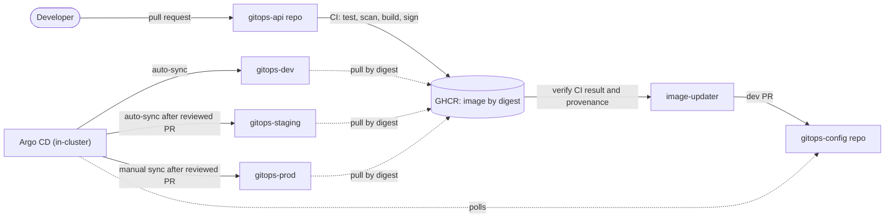

# GitOps Multi-Environment Deployment

> **Repository ownership (SEC-001):** source lives in `Dapravith/gitops-api`, deployed state in `Dapravith/gitops-config`. This umbrella repo is documentation only; its `gitops-api/` and `gitops-config/` folders are read-only snapshots synced from those repos' `main`. Do not edit them here.

> A Rust service delivered to **dev → staging → prod** with Argo CD. Every change is a Git commit, every
> environment runs the same signed image digest, and every claim is backed by captured evidence.


---

## Contents

- [Overview](#overview)
- [Architecture](#architecture)
- [Repository layout](#repository-layout)
- [Environments](#environments)
- [Getting started](#getting-started)
- [Kubernetes implementation guide](#kubernetes-implementation-guide)
- [Run the service](#run-the-service)
- [Release workflow](#release-workflow)
- [Security model](#security-model)
- [Project status](#project-status)
- [Documentation](#documentation)

## Overview

| | |
|---|---|
| **Application** | `gitops-api`: a minimal Rust 2024 / Axum service exposing `/health`, `/ready` and `/version` |
| **Delivery** | Pull-based GitOps. Argo CD reconciles the cluster from the config repository. CI never holds cluster credentials |
| **Artifact** | Multi-arch image (`linux/amd64`, `linux/arm64`) on GHCR, referenced only by `@sha256` digest, with SBOM and Sigstore provenance |
| **Promotion** | Copy one digest line from one overlay to the next, through a pull request. Nothing is rebuilt between environments |
| **Runtime** | Local [kind](https://kind.sigs.k8s.io/) cluster (lab). GitHub and GHCR are the remote side |

## Architecture



Full design: [High-Level Design](docs/design/HLD.md) · [Low-Level Design](docs/design/LLD.md).

## Repository layout

This workspace holds **two independent Git repositories** plus shared documentation.

```
GitOps-Multi-Deployment/
├── gitops-api/              # Repo 1: application source → ghcr.io/dapravith/gitops-api
│   ├── src/  tests/         #   Axum service, unit and integration tests
│   ├── Dockerfile           #   digest-pinned, cross-compiled, distroless, non-root
│   └── .github/workflows/   #   ci.yml: test → scan → build → push → attest
├── gitops-config/           # Repo 2: desired cluster state (watched by Argo CD)
│   ├── apps/gitops-api/     #   Kustomize base, components, overlays/{dev,staging,prod}
│   ├── argocd/              #   AppProjects and Applications (app-of-apps)
│   ├── platform/            #   cluster add-ons (Sealed Secrets)
│   ├── bootstrap/           #   kind cluster, Argo CD install, lab Git server
│   ├── scripts/             #   validate, set-image, promote, seal, argocd wrapper
│   └── .github/workflows/   #   validate.yml (required check), image-updater.yml
└── docs/
    ├── design/              # HLD, LLD, implementation guide
    ├── evidence/            # captured command output per phase
    ├── CHECKLIST.md         # phase-by-phase status
    └── ARCHITECTURE.md      # original phase-1 design intent
```

| Repository | Remote | Who writes |
|---|---|---|
| `gitops-api` | [github.com/Dapravith/gitops-api](https://github.com/Dapravith/gitops-api) | developers; CI publishes images |
| `gitops-config` | [github.com/Dapravith/gitops-config](https://github.com/Dapravith/gitops-config) | pull requests only (`validate` required); Argo CD reads |

## Environments

| | dev | staging | prod |
|---|---|---|---|
| Namespace | `gitops-dev` | `gitops-staging` | `gitops-prod` |
| New image arrives via | bot PR, auto-merged after `validate` | `promote.sh dev staging` PR | `promote.sh staging prod` PR |
| Argo CD sync | automated, prune, self-heal | automated, prune, self-heal | **manual** |
| Manual drift | reverted in seconds | reverted in seconds | reported as `OutOfSync` |
| Replicas | 1 | 2 + PDB | 3 + PDB + topology spread |
| Pod Security | `restricted` | `restricted` | `restricted` |

## Getting started

**Prerequisites:** Docker (with buildx), kind 0.33, kubectl 1.36, `gh`. The Rust toolchain and the
scanners (Trivy, gitleaks, kubeconform, hadolint, yq, argocd CLI) run as digest-pinned containers.

```bash
# The lab uses its own kubeconfig; your default context is never changed.
export KUBECONFIG="$HOME/.kube/gitops-lab.kubeconfig"
```

**1. Build and test the application**

```bash
cd gitops-api
scripts/cargo.sh test --locked
docker buildx build --platform linux/arm64,linux/amd64 \
  --build-arg GIT_SHA="$(git rev-parse HEAD)" -t gitops-api:local .
```

**2. Create the cluster and install Argo CD**

```bash
cd gitops-config
bootstrap/kind/create-cluster.sh        # idempotent: kind node + ghcr.io registry mirror
bootstrap/argocd/install.sh             # verifies the upstream checksum, then hands over to Git
scripts/argocd.sh app list
```

**3. Validate desired state offline**

```bash
scripts/validate.sh                     # render → schema → policy → misconfig → secret scan
```

Step-by-step instructions, with the expected output for each step: [Implementation Guide](docs/design/IMPLEMENTATION-GUIDE.md).

## Kubernetes implementation guide

How the service runs on Kubernetes, in the order you build it. Each step maps to a phase in the
[Implementation Guide](docs/design/IMPLEMENTATION-GUIDE.md), which also lists the evidence to capture.
All paths are relative to `gitops-config/`.

**Ground rules**

1. Always use the lab kubeconfig (`export KUBECONFIG="$HOME/.kube/gitops-lab.kubeconfig"`). Never change the default context.
2. After bootstrap, never `kubectl apply` into `gitops-dev`, `gitops-staging` or `gitops-prod`. Commit to Git and let Argo CD apply it.
3. Every prod sync, and every change on GitHub, needs the owner's explicit OK.

### Step 1: Cluster (phase 3)

```bash
bootstrap/kind/create-cluster.sh
kubectl get nodes -o wide               # expect: gitops-lab-control-plane  Ready  v1.36.4
```

| Setting | Value | Where |
|---|---|---|
| Topology | single schedulable control-plane node (`gitops-lab/role: all-in-one`) | `bootstrap/kind/kind-config.yaml` |
| Node image | `kindest/node:v1.36.4`, pinned by digest | same |
| API server | `127.0.0.1`, random port: reachable from this machine only | same |
| Registry | `gitops-lab-registry` on `127.0.0.1:5001`, configured in containerd as a **mirror** for `ghcr.io` | `bootstrap/kind/create-cluster.sh` |

The mirror lets manifests always reference real `ghcr.io/...@sha256:` digests. Because a digest identifies the
content, the mirror cannot serve different bytes under it.

**Verify:** in a throwaway namespace labelled `pod-security.kubernetes.io/enforce: restricted`, a default pod is rejected and a
hardened pod is admitted. Delete the namespace afterwards.

### Step 2: Desired state with Kustomize (phase 4)

```
apps/gitops-api/
├── base/                      # environment-agnostic; must not reference a namespace
│   ├── serviceaccount.yaml    #   automountServiceAccountToken: false
│   ├── deployment.yaml        #   probes, preStop, securityContext, 30s grace period
│   ├── service.yaml           #   ClusterIP :80 → :8080
│   └── networkpolicy.yaml     #   default-deny + allow from api-client only
├── components/
│   ├── pdb/                   # PodDisruptionBudget (staging, prod)
│   └── sealed-secrets-access/ # RoleBinding for the per-namespace controller
└── overlays/{dev,staging,prod}/
    ├── namespace.yaml         # PSA restricted (enforce, audit, warn), pinned to v1.36
    ├── kustomization.yaml     # APP_ENV, RUST_LOG, image digest
    └── deployment-patch.yaml  # replicas, resources, topology spread
```

Conventions:

- **The image digest is the only per-release field.** Every overlay maps the placeholder `gitops-api` to
  `ghcr.io/dapravith/gitops-api` with a `digest:`. `validate.sh` fails any rendered image without an `@sha256` digest.
- **Config changes roll the pods.** `configMapGenerator` adds a content hash to the ConfigMap name, so any change
  creates a new name and the Deployment rolls. A `git revert` brings back the previous name.
- **Selectors are written by hand.** `labels` uses `includeSelectors: false`, because Deployment selectors are
  immutable and injected labels would widen NetworkPolicy selectors.

```bash
scripts/validate.sh                     # render → kubeconform (K8s 1.36, strict) → policy → Trivy → gitleaks
                                        # expect: ALL OVERLAYS VALID, exit 0
kubectl kustomize apps/gitops-api/overlays/prod | less    # inspect one environment
```

### Step 3: Workload hardening (built into the base)

| Layer | Control |
|---|---|
| Namespace | Pod Security `restricted`, enforced in every environment |
| Pod | non-root UID/GID 65532, `seccompProfile: RuntimeDefault`, no ServiceAccount token |
| Container | read-only root filesystem, `allowPrivilegeEscalation: false`, all capabilities dropped |
| Probes | `startupProbe` and `livenessProbe` on `/health`; `readinessProbe` on `/ready` |
| Shutdown | a native `preStop: sleep 5s` (no shell needed in distroless) lets endpoint removal propagate before SIGTERM; then `/ready` returns 503 while in-flight requests drain, within a 30 s grace period |
| Network | `default-deny-all` for ingress and egress. Port 8080 accepts traffic only from pods labelled `app.kubernetes.io/role: api-client` in the same namespace. The API itself has no egress |
| Availability | staging: 2 replicas + PDB; prod: 3 replicas + PDB + `topologySpreadConstraints` |

> In prod, `whenUnsatisfiable: ScheduleAnyway` is a lab concession: the lab has one node. On a multi-node cluster,
> change it to `DoNotSchedule`.

### Step 4: Argo CD (phase 5)

```bash
bootstrap/argocd/install.sh             # verifies the upstream sha256, applies, then creates root
scripts/argocd.sh app list
# expect: root, sealed-secrets, gitops-api-dev, gitops-api-staging   Synced / Healthy
#         gitops-api-prod                                            OutOfSync (manual sync only)
```

- **App-of-apps.** `argocd/applications/root.yaml` manages every AppProject and Application under `argocd/`, including itself.
- **Projects limit the blast radius.** The `default` project is locked. `gitops-nonprod` and `gitops-prod` allow only their own
  namespaces and a fixed list of resource kinds. `platform` and `cluster-addons` hold cluster add-ons.
- **Sync options.** dev and staging use `automated: {prune, selfHeal}`, `ServerSideApply`, `PruneLast`, `FailOnSharedResource`
  and a 3-step retry with backoff. prod has no `automated` block.
- **Finalizer.** `resources-finalizer.argocd.argoproj.io`: deleting an Application also deletes its workloads.

**Verify:** apply a throwaway Application in the `default` project. Expect `InvalidSpecError` for both its repo and its destination.

### Step 5: Secrets (phase 6)

Kubernetes `Secret`s never go into Git. Seal them offline with the public certificate (`sealed-secrets/pub-cert.pem`) and
commit the `SealedSecret`. The controller in the cluster decrypts it.

```bash
printf '%s' "$VALUE" | scripts/seal.sh <env> <secret-name> <key>   # plaintext from stdin only
#   → apps/gitops-api/overlays/<env>/sealedsecret-<secret-name>.yaml (strict scope: that name, that namespace)
scripts/seal.sh --check-cert            # committed cert matches the cluster's active cert
scripts/sealed-secrets-key.sh backup    # right away; store the file outside every repo
```

`validate.sh` fails on any plaintext `Secret`. Full procedure: [SECRETS.md](gitops-config/docs/SECRETS.md).

### Step 6: Operate (phase 7)

| Task | Command | Expected |
|---|---|---|
| Check a rollout | `scripts/argocd.sh app wait gitops-api-dev --sync --health --timeout 300` | exits 0 |
| See which build is live | `kubectl -n gitops-dev get deploy gitops-api -o jsonpath='{..image}'` | the digest from `overlays/dev/kustomization.yaml` |
| Drift in dev or staging | `kubectl -n gitops-dev scale deploy gitops-api --replicas=5` | reverted within seconds |
| Drift in prod | the same against `gitops-prod` | stays `OutOfSync`, not reverted |
| Roll back | `git revert -m 1 <promotion-merge>` | dev and staging heal themselves; prod needs a manual sync |

Do **not** use `kubectl rollout undo` or `argocd app rollback` on dev or staging: self-heal puts Git's state straight back.

For load tests, use a **long-lived** pod labelled `app.kubernetes.io/role: api-client`. Short-lived `kubectl run --rm` pods
slip past kindnet's NetworkPolicy filtering for their first few moments
([phase-06 caveat](docs/evidence/phase-06.md#networkpolicy-kindnet-v20260820-69b56db7-policy-engine-ready)).

### Moving beyond kind

To run the same manifests on a real cluster:

1. Remove the `ghcr.io` mirror and pull straight from GHCR (add an `imagePullSecret` if the package is private).
2. Use a CNI that enforces NetworkPolicy from the moment a pod starts (for example Cilium or Calico).
3. Set `whenUnsatisfiable: DoNotSchedule` in prod and run at least three nodes across zones.
4. Re-seal every secret with the new cluster's certificate. Sealed data is bound to the controller's key.
5. Phase 9 of the Implementation Guide covers the rest of the target architecture.

All the day-to-day commands (inspect, debug, promote, roll back, drills, secrets), each marked with its safety level:
[Kubernetes command reference](docs/KUBERNETES-COMMANDS.md).

## Run the service

There are three ways to reach `gitops-api`. Each one serves the same endpoints.

| Mode | Use for | Needs | Address |
|---|---|---|---|
| A. Local, from source | coding and debugging | Docker | `http://127.0.0.1:8080` |
| B. Local, container image | testing the release image under hardened flags | Docker with buildx | `http://127.0.0.1:8080` |
| C. dev environment | checking what Argo CD deployed | running lab cluster | `http://127.0.0.1:8080` through a port-forward |

### A. Local, from source

Runs `cargo run` inside the pinned Rust 1.99.0 container. `PUBLISH=1` publishes port 8080 on `127.0.0.1` only.

```bash
cd gitops-api
PUBLISH=1 APP_ENV=local LOG_FORMAT=pretty scripts/cargo.sh run
```

With `rustup` installed you can run `cargo run` directly. `rust-toolchain.toml` selects the same compiler.

### B. Local, container image

Builds the release image, then runs it with the same restrictions Kubernetes applies: read-only root filesystem, no capabilities, no privilege escalation.

```bash
cd gitops-api
docker buildx build --build-arg GIT_SHA="$(git rev-parse HEAD)" -t gitops-api:local --load .
docker run --rm --read-only --cap-drop ALL --security-opt no-new-privileges \
  -p 127.0.0.1:8080:8080 -e APP_ENV=local gitops-api:local
```

`docker stop` sends SIGTERM. The service stops taking new requests (`/ready` returns 503), finishes the ones in flight, and exits with code 0.

### C. dev environment (in the lab cluster)

The dev Service is `ClusterIP` only, and its NetworkPolicy admits only pods labelled `app.kubernetes.io/role: api-client`.
Reach it from your machine with a port-forward:

```bash
export KUBECONFIG="$HOME/.kube/gitops-lab.kubeconfig"
scripts/argocd.sh app wait gitops-api-dev --sync --health --timeout 300   # run from gitops-config/
kubectl -n gitops-dev port-forward svc/gitops-api 8080:80
```

Use `gitops-staging` the same way. For `gitops-prod`, use read-only checks only.

> The port-forward route has not been captured in [evidence](docs/evidence/) yet. Earlier phases reached the
> dev Service from an in-cluster `api-client` pod ([phase-06](docs/evidence/phase-06.md)).

### Check it

```bash
curl -s http://127.0.0.1:8080/health    # {"status":"ok"}
curl -s http://127.0.0.1:8080/ready     # {"status":"ready"}       (503 {"status":"not_ready"} while starting or draining)
curl -s http://127.0.0.1:8080/version   # {"name":"gitops-api","version":"0.1.0","git_sha":"<commit>","environment":"<APP_ENV>"}
```

In mode C, `environment` is `dev` and `git_sha` is the commit of the deployed digest. That's how you confirm which build is live.

### Configuration

| Variable | Default | Valid values |
|---|---|---|
| `PORT` | `8080` | 1–65535 |
| `APP_ENV` | `local` | `[a-z0-9-]+` (the overlay sets `dev`, `staging` or `prod`) |
| `LOG_FORMAT` | `json` | `json` or `pretty` |
| `RUST_LOG` | `info` | `EnvFilter` syntax, e.g. `info,gitops_api=debug` |

A value that is set but invalid stops the service at startup with exit code 1, e.g.
`configuration error: PORT must be an integer between 1 and 65535, got "0"`.

## Release workflow

```bash
scripts/promote.sh dev staging          # gated: source Synced/Healthy, live pods match Git digest
scripts/promote.sh staging prod         # creates promote/<env>-<digest12> with a one-line diff
scripts/argocd.sh app sync gitops-api-prod   # prod only: explicit release step after merge
```

**Rollback** is a `git revert -m 1 <promotion-merge>`. dev and staging roll back automatically;
prod needs a manual sync. Full procedure: [PROMOTION.md](gitops-config/docs/PROMOTION.md).

## Security model

| Control | Implementation |
|---|---|
| No cluster credentials outside the cluster | Pull-based Argo CD; CI only pushes images |
| Immutable, verified artifacts | Digest-only images; SLSA provenance signed with Sigstore and verified before promotion |
| Pinned supply chain | Actions pinned by commit SHA; base images and tools pinned by digest |
| Scanning gates | Trivy (crates, image, manifests) blocks fixable HIGH/CRITICAL; gitleaks scans the full history |
| Workload hardening | Non-root UID 65532, read-only root FS, all capabilities dropped, seccomp, no SA token, default-deny NetworkPolicy |
| Blast-radius limits | Locked `default` AppProject; per-environment allow-lists for kinds and Namespaces by name |
| Secrets | [Sealed Secrets](gitops-config/docs/SECRETS.md): offline sealing, strict scope, per-namespace controller RBAC |

## Project status

As of **2026-11-13**. Details and evidence: [CHECKLIST.md](docs/CHECKLIST.md).

| Area | Status |
|---|---|
| Application, image, cluster, Kustomize overlays | ✅ verified |
| Argo CD, dev auto-sync, prod manual sync, drift and rollback drills | ✅ verified in the lab |
| Sealed Secrets (dev, staging) | ✅ verified · prod not enabled |
| GitHub CI: build, scan, publish, provenance | ✅ verified |
| Automated dev promotion (image-updater) | ❌ failing: see [Implementation Guide §8.3](docs/design/IMPLEMENTATION-GUIDE.md#83-fix-the-image-updater-defect-b5) |
| Enforced PR approval for staging/prod | ❌ not enforced (single maintainer) |
| Argo CD sourcing from GitHub | ⬜ merged, not yet verified on a cluster |
| Runbooks and audit report | ⬜ not started |

**Legend:** ✅ verified by captured output · 🟡 partial · ⬜ not done or not verified · ❌ known defect

## Documentation

| Document | Purpose |
|---|---|
| [High-Level Design](docs/design/HLD.md) | Goals, components, trust boundaries, decisions, measured results, target architecture |
| [Low-Level Design](docs/design/LLD.md) | Module, manifest, pipeline and tooling details with `file:line` references |
| [Implementation Guide](docs/design/IMPLEMENTATION-GUIDE.md) | Phase-by-phase steps: do, verify, capture |
| [Checklist](docs/CHECKLIST.md) | Current status per phase |
| [Evidence](docs/evidence/) | Raw command output behind every ✅ |
| [Kubernetes command reference](docs/KUBERNETES-COMMANDS.md) | Practical kubectl / Argo CD commands per task, with safety level and best practices |
| [Promotion runbook](gitops-config/docs/PROMOTION.md) | Promote, verify, roll back, handle drift |
| [Secrets runbook](gitops-config/docs/SECRETS.md) | Seal, rotate, back up and restore |
| [Original architecture](docs/ARCHITECTURE.md) | Phase-1 design intent (superseded by the HLD) |
