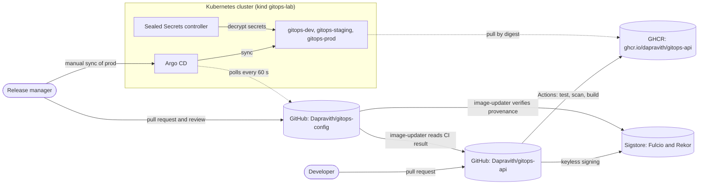
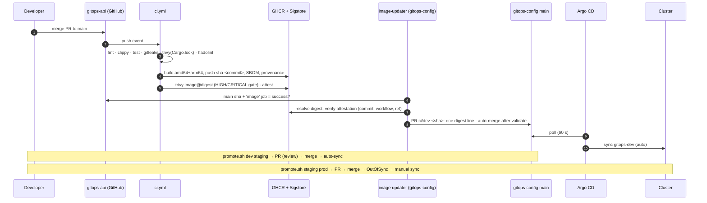

# High-Level Design: GitOps Multi-Environment Delivery

| | |
|---|---|
| Status | Baseline, 2026-11-13 |
| Scope | `gitops-api` (Rust service + CI) and `gitops-config` (desired state + Argo CD), on a local kind lab with GitHub/GHCR as the remote side |
| Companion docs | [LLD.md](LLD.md) · [IMPLEMENTATION-GUIDE.md](IMPLEMENTATION-GUIDE.md) · [../CHECKLIST.md](../CHECKLIST.md) |
| Supersedes | [../ARCHITECTURE.md](../ARCHITECTURE.md) (kept as the original phase-1 intent) |

## 0. How to read the evidence in this document

Every technical claim carries a status and an evidence link. Nothing is marked ✅ without captured command output.

| Mark | Meaning |
|---|---|
| ✅ | Verified by a real run. The link points to the captured output, with its date |
| 🟡 | Partly verified. The note says which part is not |
| ⬜ | Designed and committed, never exercised |
| ❌ | Verified **not** to work, or found missing |

Evidence IDs (E-nn) are listed in the [evidence register](#11-evidence-register) at the end.
Live-cluster evidence is from **2026-11-12**. On 2026-11-13 the lab was down (Docker stopped,
[B1](../evidence/2026-11-13-design-baseline.md#b1-lab-runtime-is-currently-down)), so today's re-checks are
offline and GitHub-side only.

---

## 1. Problem and goals

Deploy one service to **dev → staging → prod** so that every change to a running environment is a Git
commit, and every environment runs a byte-identical, scanned, signed artifact.

| # | Requirement | Design answer | Status |
|---|---|---|---|
| G1 | No human or CI job runs `kubectl apply` against app namespaces | Pull-based CD: Argo CD in the cluster reads Git | ✅ E-07, E-10 |
| G2 | Same artifact in all environments | Overlays pin `image@sha256`; promotion copies the digest string | ✅ E-12 |
| G3 | dev updates automatically; staging after review; prod only on explicit release | Sync policy per environment + PR gates | 🟡 dev/prod ✅ E-10, E-12. Staging review is ❌ on GitHub: 0 approvals required (E-21) |
| G4 | Drift is corrected (non-prod) or surfaced (prod) | `selfHeal` on dev/staging, none on prod | ✅ E-11, E-12 |
| G5 | Rollback in one reviewed change, without downtime | `git revert` of the promotion merge | ✅ E-14 (staging). Prod rollback not run |
| G6 | No plaintext secrets in Git | Sealed Secrets + policy ban + gitleaks | ✅ E-16, E-17 |
| G7 | Supply chain: pinned inputs, scans block HIGH/CRITICAL, provenance | Digest pins, Trivy, SLSA provenance via Sigstore | ✅ E-04, E-19, E-20 |
| G8 | Zero failed requests during rollout | Readiness + preStop + `maxUnavailable: 0` | ✅ E-08, E-13 |

Non-goals: databases, ingress/TLS from outside the cluster, multi-cluster, autoscaling. The app is
deliberately trivial, so that the delivery system is what gets tested.

## 2. System context

**Direction of trust is inward.** The cluster pulls from Git and the registry. Nothing outside the cluster
holds cluster credentials (✅ E-07: Argo CD Services are ClusterIP only, and CI has no kubeconfig).

## 3. Containers and responsibilities

| Element | Responsibility | Runs where | Key tech (pinned) |
|---|---|---|---|
| `gitops-api` service | `/health`, `/ready`, `/version`. Graceful drain | Pods in 3 namespaces | Rust 1.99.0, Axum 0.8, Tokio, distroless `cc-debian13:nonroot` |
| `gitops-api` CI | fmt, clippy, tests, gitleaks, Trivy (crates + image), hadolint, multi-arch build, SBOM, provenance | GitHub Actions | actions pinned by commit SHA, scanners by image digest |
| GHCR | Stores images; deployments reference digests only | GitHub | — |
| `gitops-config` repo | Single source of truth for desired state | GitHub, `main` protected by ruleset | Kustomize base + overlays + components |
| `validate` workflow | Required check: render → schema → policy → misconfig → secret scan | GitHub Actions | kubectl 1.36.1 (checksum), kubeconform, Trivy, gitleaks |
| `image-updater` workflow | Proposes a new **dev** digest after verifying CI result + attestation | GitHub Actions, cron `*/10` | `gh attestation verify` |
| Argo CD | Reconciles Git → cluster. App-of-apps | `argocd` ns, PSA restricted | v3.5.7, `--core` mode, no Dex |
| Sealed Secrets | Decrypts `SealedSecret` → `Secret` in opted-in namespaces | `sealed-secrets` ns | v0.41.2 |
| Lab Git server *(transitional)* | Read-only smart-HTTP mirror used before GitHub existed | Docker container | alpine + lighttpd `git http-backend` |
| Lab registry *(lab only)* | containerd mirror for `ghcr.io`. A digest can't be substituted | Docker container | `registry:3.1.1` |

## 4. Delivery flow

| Step | Status | Evidence |
|---|---|---|
| 1–5 CI builds, scans, publishes and attests | ✅ | E-19, E-20 (run `28ae24b`, digest `910d9b7b…` verified) |
| 6–8 image-updater opens the dev PR | ❌ | E-22: blocked by a repo setting, then by a stale branch |
| 9–10 dev auto-sync | ✅ lab | E-10 (lab Git server; 69 s detect + 5 s apply) |
| staging promotion | 🟡 | E-13 (gates and zero-downtime proven; reviewer approval not enforced, E-21) |
| prod manual sync | ✅ lab | E-12 (no sync for 4 min after merge; manual sync took 3 s) |
| Argo CD reading **GitHub** (PR #1) | ⬜ | merged 2026-11-12, but no cluster run since. Repos are public, so no credentials are needed |

## 5. Environment policy

| | dev | staging | prod |
|---|---|---|---|
| How a new digest arrives | bot PR, auto-merge after `validate` | `promote.sh dev staging` PR | `promote.sh staging prod` PR |
| Human gate | none | PR review *(intended, not enforced: E-21)* | PR review *(not enforced)* **+ manual Argo CD sync** ✅ |
| Argo CD sync | automated, prune, selfHeal | automated, prune, selfHeal | manual |
| Deleting the Application | cascades (finalizer) | cascades | **does not cascade** (no finalizer) |
| Replicas / PDB | 1 / none | 2 / maxUnavailable 1 | 3 / maxUnavailable 1, topology spread |
| Requests → limit (mem) | 10m/16Mi → 64Mi | 25m/24Mi → 96Mi | 50m/32Mi → 128Mi |
| Sealed Secrets | enabled | enabled | not enabled (needs a prod sync) |
| Drift | reverted in 1.4–24.8 s ✅ E-11 | reverted | reported `OutOfSync`, kept until sync ✅ E-12 |

## 6. Trust boundaries and credentials

The design question: **who could change production, and with what credential?**

| Actor | Holds | Can do | Cannot do | Evidence |
|---|---|---|---|---|
| `gitops-api` CI | `GITHUB_TOKEN` (packages:write, id-token, attestations) | push images to GHCR, sign provenance | write to `gitops-config`; reach the cluster | ✅ E-19, [ci.yml](../../gitops-api/.github/workflows/ci.yml) |
| `image-updater` | `gitops-config` `GITHUB_TOKEN` (contents/PR/actions write) | push `ci/*` branches, open a dev PR | push to `main` (ruleset); touch any file except the dev digest line (validate rule) | 🟡 rules ✅ E-21; PR creation ❌ E-22 |
| Maintainer | GitHub account, lab kubeconfig | merge PRs; sync prod | bypass `validate` on `main` (no bypass actors) | ✅ E-21 |
| Argo CD | in-cluster SA (`*/*/*`, upstream default) | apply what an AppProject allows | deploy outside allowed namespaces/kinds; create arbitrary Namespaces | ✅ E-15 |
| Sealed Secrets | private key in `sealed-secrets` ns | decrypt for `gitops-dev`, `gitops-staging` | read Secrets in prod, `argocd` or `kube-system` | ✅ E-16 |
| App pods | nothing (no SA token, no egress) | serve HTTP to `api-client` pods | call the API server; reach the internet | ✅ E-09, E-15 |

**Known weak points (accepted or open):**
- ❌ Single maintainer means no enforced second reviewer (E-21). Mitigation: prod also needs a manual sync, and on a real team set `required_approving_review_count ≥ 1` plus CODEOWNERS for `overlays/prod/`.
- 🟡 Who may sync prod is defined in `argocd-rbac-cm` (`role:release-manager`) but not exercised. `--core` mode uses kube RBAC, so anyone with the kubeconfig can sync (E-12 notes).
- 🟡 The Argo CD controller has cluster-wide rights (upstream). AppProject allow-lists contain them (E-15).
- ⬜ The cluster doesn't verify signatures at admission. Provenance is checked **before** the PR (image-updater), not at pull time.

## 7. Key architecture decisions

| ID | Decision | Alternatives considered | Why this one | Proof |
|---|---|---|---|---|
| D1 | Pull-based CD (Argo CD) | push from CI with `kubectl`/Helm | no cluster credential outside the cluster; drift detection for free | E-07, E-11, E-18 |
| D2 | Two repos (app vs config) | monorepo | CI can't write desired state; config history = deployment history | E-19, E-21 |
| D3 | Digest pinning, promotion = copy the digest | tag per env; rebuild per env | immutable, so staging/prod run what dev tested | E-12 (same digest live ×6 pods) |
| D4 | Kustomize base/overlays/components | Helm | no templating; diff = exact change; one-line promotions | E-06, E-13 (1-line diff) |
| D5 | **Pull**-based image updater in the config repo | CI pushes PR with a PAT | no long-lived cross-repo token. Trust = verified attestation | E-20; 28ae24b removed the PAT job |
| D6 | prod manual sync, no finalizer | auto-sync with sync windows | merging can't deploy prod; deleting the App can't delete prod | E-12 |
| D7 | Sealed Secrets, strict scope, per-namespace RBAC | External Secrets + vault; SOPS | no external dependency in a lab; ciphertext safe in Git | E-16, E-17 |
| D8 | Layered policy: offline `policy_check.py` + AppProject + PSA `restricted` | admission controller (Kyverno/Gatekeeper) | zero extra components; each layer caught a different test case | E-15 (PSA stopped the privileged pod after the AppProject let it through) |
| D9 | distroless glibc image, cross-compiled | musl + `static`; alpine | small (11.5–11.8 MB), no shell, native-speed cross build | E-04 |
| D10 | Single-node kind | multi-node | shared Docker VM is CPU/memory-starved | E-05, E-07 incident |

## 8. Quality attributes: measured, not claimed

| Attribute | Measurement | Evidence |
|---|---|---|
| Availability during rollout | 980/0, 1905/0 (ok/failed requests) | E-08, E-13 |
| Availability during rollback | 2211/0, previous digest live in 20 s | E-14 |
| Bad release contained | bad digest: old pod kept serving; bad config: 1964/0 | E-14 (F1, F2) |
| Control-plane outage | Git down: 1357/0; Argo CD controller down: 1077/0 | E-14 (O1, O2) |
| Time to deploy (dev) | 69 s detect (polling) + 5 s apply | E-10 |
| Drift correction | 1.4–24.8 s | E-11 |
| Image attack surface | no shell, UID 65532, 0 HIGH/CRITICAL fixable; 53 unfixed MEDIUM/LOW in the base | E-04 |
| Dependency CVEs | Cargo.lock: 70 crates, 0 | E-14 (S2) |

Caveat: all numbers come from a host with a load average of 20–80 on 8 vCPU (shared Docker VM).
Treat the timings as upper bounds.

## 9. Failure modes

| Failure | Behaviour | Detection | Recovery | Status |
|---|---|---|---|---|
| Digest not in registry | new pod `ImagePullBackOff`, old pod serves | Argo `Degraded`; `promote.sh` gate refuses | revert; `set-image.sh` now checks the registry first | ✅ fixed E-14 |
| Config app rejects | `CrashLoopBackOff`, old pod serves | Argo `Progressing`/`Degraded` | revert; `policy_check.py` now mirrors app rules | ✅ fixed E-14 |
| Git unreachable | workloads unaffected; **self-heal paused** | `ComparisonError` | restore Git | ✅ E-14 — needs alerting (⬜) |
| Argo CD controller down | workloads unaffected; drift not corrected | controller pod not Ready | restart | ✅ E-14 |
| Hand-made object in namespace | kept, warned | `OrphanedResourceWarning` | delete via Git | ✅ E-14 |
| Hand-added field not in Git | **not detected** | — | — | ✅ limitation (E-14 D2) |
| Sealing key lost | SealedSecrets can't decrypt | `ErrUnsealFailed` | restore the key backup before syncing | ✅ drill E-16 |
| Image-updater stuck | dev never gets new builds | failed scheduled runs | fix B5 | ❌ open E-22 |

## 10. Target architecture (beyond the lab)

What would change for a real deployment. **None of this is built**; each row is a proposed next step,
with a test that would prove it done.

| Area | Lab today | Target | Done when (evidence to capture) |
|---|---|---|---|
| Git → Argo latency | 60 s polling | GitHub webhook to `argocd-server` (needs ingress + TLS) | commit→sync < 10 s, measured |
| Prod authorisation | kube RBAC via kubeconfig | SSO (OIDC) + `role:release-manager` + `argocd` CLI login | non-member gets `permission denied` on sync |
| Review enforcement | 0 approvals | ≥1 approval, CODEOWNERS on `overlays/{staging,prod}/`, a second account or team | merge blocked without approval (screenshot or API output) |
| Signature at admission | checked pre-PR only | Kyverno/`policy-controller` `verifyImages` for `ghcr.io/dapravith/*` | unsigned digest is rejected by admission |
| Observability | logs only | Prometheus metrics endpoint, Argo CD + app alerts (`ComparisonError`, `Degraded`, controller down) | alert fires in an O1 re-run |
| HA | 1 node | ≥3 nodes, `whenUnsatisfiable: DoNotSchedule`, Argo CD HA manifests | node drain with 0 failed requests |
| Image | glibc distroless (53 unfixed base findings) | musl + `distroless/static` | Trivy all-severity = 0 |
| Versions | Argo CD 3.5.7, K8s 1.36.4, Rust 1.99.0 | Argo CD 3.6.x, K8s 1.37.x, Rust 1.100 (B7) | upgrade PRs green + re-run of phase 13 |

## 11. Evidence register

| ID | Claim | Source (captured) |
|---|---|---|
| E-01 | toolchain pinned; tests, fmt, clippy pass | [phase-01-03](../evidence/phase-01-03.md) (2026-11-12) |
| E-02 | endpoints and fail-fast config | [phase-01-03 smoke test](../evidence/phase-01-03.md#phase-23--runtime-smoke-test) |
| E-03 | SIGTERM → exit 0, JSON logs | [phase-01-03](../evidence/phase-01-03.md) |
| E-04 | multi-arch image, no shell, UID 65532, Trivy gate | [phase-04](../evidence/phase-04.md) |
| E-05 | kind cluster, PSA restricted rejects/admits | [phase-05](../evidence/phase-05.md) |
| E-06 | overlays validate; 4 negative tests fail | [phase-06](../evidence/phase-06.md) + today [B2](../evidence/2026-11-13-design-baseline.md#b2-offline-validation-re-run-today-no-docker-needed) |
| E-07 | Argo CD install, projects, apps; prod not auto-synced | [phase-07](../evidence/phase-07.md) |
| E-08 | zero-downtime rollout 980/0 | [phase-06](../evidence/phase-06.md#zero-downtime-rollout-staging-2-replicas) |
| E-09 | NetworkPolicy allow/deny matrix | [phase-06](../evidence/phase-06.md#networkpolicy-kindnet-v20260820-69b56db7-policy-engine-ready) |
| E-10 | dev auto-sync timings | [phase-10-12](../evidence/phase-10-12.md#phase-10--dev-auto-sync) |
| E-11 | self-heal of 4 drift types | [phase-10-12](../evidence/phase-10-12.md#phase-10--dev-auto-sync) |
| E-12 | prod manual sync; same digest in all envs; prod drift reported | [phase-10-12](../evidence/phase-10-12.md#phase-12--prod-requires-a-manual-sync) |
| E-13 | staging promotion 1-line diff, 1905/0 | [phase-10-12](../evidence/phase-10-12.md#phase-11--reviewed-promotion-dev--staging) |
| E-14 | security, failure, rollback, drift, outage tests | [phase-13](../evidence/phase-13.md) |
| E-15 | AppProject boundaries + PSA layering; runtime posture | [phase-13 S4–S6](../evidence/phase-13.md#s4s5--argo-cd-project-boundaries) |
| E-16 | Sealed Secrets install, scope/tamper tests, key drill | [sealed-secrets](../evidence/sealed-secrets.md) |
| E-17 | gitleaks clean history + negatives | [sealed-secrets](../evidence/sealed-secrets.md#secret-scanning-gitleaks-v8301-digest-pinned) |
| E-18 | workloads survive Git/Argo outage | [phase-13 O1/O2](../evidence/phase-13.md#drift-and-outages) |
| E-19 | GitHub CI green on `28ae24b` | [baseline B3](../evidence/2026-11-13-design-baseline.md#b3-github-state-phase-8-has-started) (2026-11-13) |
| E-20 | provenance of `910d9b7b…` verified | [baseline B4](../evidence/2026-11-13-design-baseline.md#b4-published-image--provenance-verified) |
| E-21 | ruleset: PR + validate, 0 approvals; `gitops-api` unprotected | [baseline B6](../evidence/2026-11-13-design-baseline.md#b6-branch-rules-review-is-not-enforced) |
| E-22 | image-updater failing (setting + stale branch) | [baseline B5](../evidence/2026-11-13-design-baseline.md#b5-defect-image-updater-cannot-open-the-dev-pr) |
| E-23 | version currency | [baseline B7](../evidence/2026-11-13-design-baseline.md#b7-version-currency-github-releaseslatest-read-today) |
