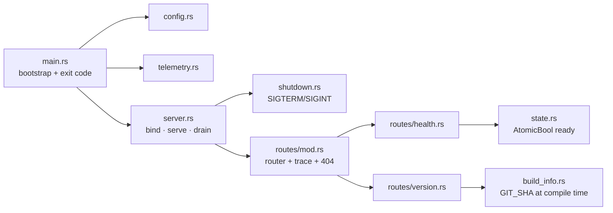
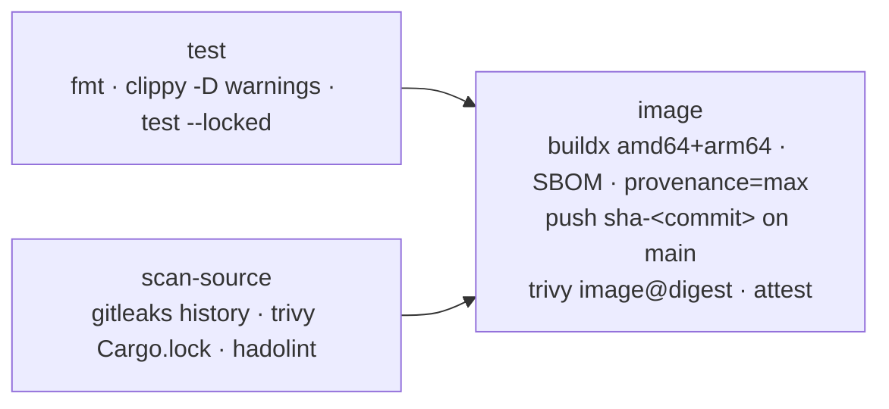

# Low-Level Design: GitOps Multi-Environment Delivery

Companion to [HLD.md](HLD.md). Status marks (✅ 🟡 ⬜ ❌) and evidence IDs (E-nn) mean the same as there.
Each section names the file and lines that implement it, so the design can be checked against the code.

---

## 1. Application: `gitops-api`

### 1.1 Module structure



Rule: dependencies point one way, `main → server → routes → state`. Handlers never read env vars
or touch the listener ([lib.rs:17-18](../../gitops-api/src/lib.rs#L17-L18)). `unsafe_code = "forbid"` and
`clippy::pedantic` are on ([Cargo.toml:25-29](../../gitops-api/Cargo.toml#L25-L29)).

### 1.2 HTTP contract

| Method + path | 200 body | Other | Used by | Code |
|---|---|---|---|---|
| `GET /health` | `{"status":"ok"}` | never consults state | liveness + startup probe | [health.rs:17-20](../../gitops-api/src/routes/health.rs#L17-L20) |
| `GET /ready` | `{"status":"ready"}` | **503** `{"status":"not_ready"}` before serving and while draining | readiness probe | [health.rs:22-31](../../gitops-api/src/routes/health.rs#L22-L31) |
| `GET /version` | `{"name","version","git_sha","environment"}` | — | promotion proof | [version.rs:22-27](../../gitops-api/src/routes/version.rs#L22-L27) |
| anything else | — | **404** `{"status":"not_found"}`; wrong method → **405** | — | [routes/mod.rs:47-49](../../gitops-api/src/routes/mod.rs#L47-L49) |

Proof: integration tests `health_is_ok_even_when_not_ready`, `ready_reflects_state`, `version_reports_build_and_environment`,
`unknown_route_is_json_404`, `wrong_method_is_405` ([tests/api.rs](../../gitops-api/tests/api.rs)) ✅ E-01. Live
responses in all three namespaces ✅ E-06.

### 1.3 Readiness lifecycle (the zero-downtime mechanism)

```mermaid
stateDiagram-v2
  [*] --> NotReady: AppState::new (ready=false)
  NotReady --> Ready: serve() starts, set_ready(true)
  Ready --> Draining: SIGTERM/SIGINT, set_ready(false)
  Draining --> [*]: in-flight requests done, exit 0
```

- Starts **not ready**: [state.rs:15-22](../../gitops-api/src/state.rs#L15-L22). `Acquire`/`Release` ordering: [state.rs:31-37](../../gitops-api/src/state.rs#L31-L37).
- Flip on serve and on shutdown: [server.rs:57-69](../../gitops-api/src/server.rs#L57-L69) (`with_graceful_shutdown`).
- Signals: [shutdown.rs:14-20](../../gitops-api/src/shutdown.rs#L14-L20). If a handler can't be installed, that signal is treated as never arriving, so the server doesn't exit immediately (lines 22-42).
- Proof: `real_server_serves_and_shuts_down_gracefully` (real TCP, ephemeral port) ✅ E-01. `docker stop` → exit 0 ✅ E-03.
  `kubectl delete pod` → gone in 1.2 s ✅ E-05.

**Timing in Kubernetes** (combined with §3.2):

```
t=0      pod marked Terminating → removed from EndpointSlice (async)
t=0..5s  preStop sleep 5 s: process still serving, kube-proxy catches up
t=5s     SIGTERM → /ready=503, stop accepting, drain in-flight
t≤30s    terminationGracePeriodSeconds hard limit (app exits in ms)
```

The 5 s sleep exists because phase 5 found the app exits about 1 ms after SIGTERM (E-05, "findings carried forward").

### 1.4 Configuration contract

Unset variables take their default. A variable that is **set but invalid fails startup with exit 1**,
before logging starts ([main.rs:8-15](../../gitops-api/src/main.rs#L8-L15)).

| Var | Default | Valid | Code | Offline mirror in policy |
|---|---|---|---|---|
| `PORT` | 8080 | integer 1–65535 | [config.rs:98-103](../../gitops-api/src/config.rs#L98-L103) | ✅ `check_app_config` |
| `APP_ENV` | `local` | `[a-z0-9-]+` (namespace alphabet) | [config.rs:107-117](../../gitops-api/src/config.rs#L107-L117) | ✅ must equal overlay name |
| `LOG_FORMAT` | `json` | `json` \| `pretty` \| `text` | [config.rs:27-37](../../gitops-api/src/config.rs#L27-L37) | ✅ |
| `RUST_LOG` | `info` | `EnvFilter` syntax; invalid → fallback + WARN | [telemetry.rs:50-60](../../gitops-api/src/telemetry.rs#L50-L60) | — |

`from_lookup` takes a closure so tests never mutate the process environment (`set_var` is `unsafe` in
Rust 2024): [config.rs:67-89](../../gitops-api/src/config.rs#L67-L89). Unit tests cover defaults, all values,
and bad port/env/format. Why the policy mirror exists: F2 (`PORT=0`) passed every offline check before it
was added ✅ E-14.

### 1.5 Errors and logging

`Error` = `Config | Telemetry | Bind | Serve` ([error.rs:11-28](../../gitops-api/src/error.rs#L11-L28)). Every variant exits 1.
Logs are one JSON object per line, flattened, with the current span ([telemetry.rs:27-38](../../gitops-api/src/telemetry.rs#L27-L38)).
One INFO span per request, one INFO event per response ([routes/mod.rs:40-45](../../gitops-api/src/routes/mod.rs#L40-L45)).

---

## 2. Container image

[Dockerfile](../../gitops-api/Dockerfile)

| Concern | Implementation | Line |
|---|---|---|
| Pinned inputs | frontend, `rust:1.99.0-slim-trixie`, `distroless/cc-debian13:nonroot` by digest | 1, 15-16 |
| Native-speed multi-arch | builder `FROM --platform=$BUILDPLATFORM`; cross gcc only when `TARGETARCH != BUILDARCH` | 19, 31-42 |
| Reproducible deps | `cargo build --release --locked` | 56-60 |
| Traceability | `GIT_SHA` build-arg → binary + OCI `revision` label | 54, 65-71 |
| Least privilege | `USER 65532:65532` (numeric, so `runAsNonRoot` can verify it) | 79 |
| Signals | exec-form `ENTRYPOINT`; binary is PID 1 | 84 |
| Small context | `.dockerignore` allow-list: `Cargo.toml`, `Cargo.lock`, `src/` | [.dockerignore](../../gitops-api/.dockerignore) |

Release profile: `lto=thin`, `codegen-units=1`, `panic=abort`, `strip` ([Cargo.toml:31-35](../../gitops-api/Cargo.toml#L31-L35)).
Result: 11.8 MB arm64 / 11.5 MB amd64, binary 1.6–1.7 MB, no `/bin/sh` ✅ E-04.

---

## 3. Kubernetes desired state (`gitops-config/apps/gitops-api`)

### 3.1 Layout and composition

```
base/                      ServiceAccount, Deployment, Service, 3× NetworkPolicy, ConfigMap generator
components/pdb/            PDB (opt-in, never with 1 replica)
components/sealed-secrets-access/   RoleBinding for the controller in this namespace
overlays/<env>/            namespace (PSA labels), replicas, resources, config, IMAGE DIGEST
```

- Labels without selectors (`includeSelectors: false`), so labels never leak into NetworkPolicy or immutable Deployment selectors: [base/kustomization.yaml:12-21](../../gitops-config/apps/gitops-api/base/kustomization.yaml#L12-L21). Bug found in phase 6 ✅ E-08/E-09.
- Hash-suffixed ConfigMap, so any config change rolls the Deployment and a revert restores the old hash: [base/kustomization.yaml:23-30](../../gitops-config/apps/gitops-api/base/kustomization.yaml#L23-L30).
- **The digest is the only line promotion changes:** [overlays/dev/kustomization.yaml:31-34](../../gitops-config/apps/gitops-api/overlays/dev/kustomization.yaml#L31-L34) (same shape in staging and prod).

### 3.2 Deployment spec

[base/deployment.yaml](../../gitops-config/apps/gitops-api/base/deployment.yaml)

| Setting | Value | Why | Line |
|---|---|---|---|
| Strategy | `maxUnavailable: 0`, `maxSurge: 1` | capacity never drops below the replica count | 10-14 |
| `minReadySeconds` / `progressDeadlineSeconds` | 5 / 120 | a pod must stay Ready 5 s; a stuck rollout goes `Degraded` in 2 min | 8-9 |
| SA token / service links | off / off | app never calls the API; no env-var injection | 26-27 |
| Pod security | non-root 65532, seccomp `RuntimeDefault` | PSA `restricted` | 29-35 |
| Container security | no privilege escalation, RO root FS, drop ALL | PSA `restricted` | 53-58 |
| Resources | CPU request, **no CPU limit**, memory limit | avoid CFS throttling (Trivy KSV-0011 accepted) | 47-52 |
| startupProbe | `/health`, 1 s × 30 | up to 30 s to start, then the other probes take over | 59-64 |
| readinessProbe | `/ready`, 5 s × 2 | out of endpoints ≤10 s after 503 | 65-70 |
| livenessProbe | `/health`, 10 s × 3 | restart after ~30 s hung | 71-76 |
| preStop | native `sleep: 5` (no shell needed) | see §1.3 | 77-82 |

Overlay deltas (replicas, resources, topology spread) are in HLD §5 and in each `deployment-patch.yaml`.
Prod uses `ScheduleAnyway` only because the lab has one node
([overlays/prod/deployment-patch.yaml:9-17](../../gitops-config/apps/gitops-api/overlays/prod/deployment-patch.yaml#L9-L17)).

### 3.3 Network policy matrix

[base/networkpolicy.yaml](../../gitops-config/apps/gitops-api/base/networkpolicy.yaml): default-deny for ingress **and** egress (10-16).
The API accepts 8080 only from pods labelled `app.kubernetes.io/role: api-client` (21-35). Those clients get egress to the API and DNS only (40-66).

| From → To | Result (measured) |
|---|---|
| api-client → API (same ns) | ✅ allowed |
| api-client → internet / prod API | ✅ blocked |
| unlabelled pod → API / internet / DNS | ✅ blocked |
| API → anything | no egress rule (none needed) |

Evidence E-09, with one caveat: kindnet adds a pod to its nftables set only shortly after the pod starts.
Short-lived pods were briefly unfiltered. Re-test on a different CNI.

### 3.4 PDB

`maxUnavailable: 1`, `unhealthyPodEvictionPolicy: AlwaysAllow` ([components/pdb/pdb.yaml](../../gitops-config/apps/gitops-api/components/pdb/pdb.yaml)).
Included in staging and prod only. With 1 replica a PDB would block node drains ([components/pdb/kustomization.yaml:1-2](../../gitops-config/apps/gitops-api/components/pdb/kustomization.yaml#L1-L2)).

---

## 4. Argo CD objects (`gitops-config/argocd`)

### 4.1 AppProjects: blast-radius control

| Project | Sources | Destinations | Cluster-scoped allowed | Namespaced allowed |
|---|---|---|---|---|
| `default` | none | none | none | none ([default.yaml:10-13](../../gitops-config/argocd/projects/default.yaml#L10-L13)) |
| `platform` | config repo | `argocd` | none | `Application`, `AppProject` |
| `cluster-addons` | config repo | `sealed-secrets` | 5 objects **by name** | Service, SA, Deployment, Role, RoleBinding |
| `gitops-nonprod` | config repo | `gitops-dev`, `gitops-staging` | `Namespace` **by name** ([gitops-nonprod.yaml:21-27](../../gitops-config/argocd/projects/gitops-nonprod.yaml#L21-L27)) | ConfigMap, Service, SA, Deployment, NetworkPolicy, PDB, SealedSecret, RoleBinding |
| `gitops-prod` | config repo | `gitops-prod` | `Namespace/gitops-prod` | same as nonprod |

Every project still lists the lab Git server as a second source, marked `TRANSITION`. Remove it once Argo CD
has been verified against GitHub (Implementation Guide 8.5).
Proof: forbidden kinds and foreign namespaces refused. A Namespace-by-name gap was found and fixed ✅ E-15.
RoleBinding is allowed by kind, so `policy_check.py` pins its exact shape (sealed-secrets evidence, "Overlay RBAC guard") ✅ E-16.

### 4.2 Applications

| App | Project | Path | Sync | Finalizer | File |
|---|---|---|---|---|---|
| `root` | platform | `argocd/` (recurse) | auto, prune, selfHeal | — | [root.yaml](../../gitops-config/argocd/applications/root.yaml) |
| `sealed-secrets` | cluster-addons | `platform/sealed-secrets` | auto, wave −1 | **none** (protects the key) | [sealed-secrets.yaml:6-10](../../gitops-config/argocd/applications/sealed-secrets.yaml#L6-L10) |
| `gitops-api-dev` | gitops-nonprod | `overlays/dev` | auto, prune, selfHeal | cascade | [gitops-api-dev.yaml:10-11,25-28](../../gitops-config/argocd/applications/gitops-api-dev.yaml#L10-L28) |
| `gitops-api-staging` | gitops-nonprod | `overlays/staging` | auto, prune, selfHeal | cascade | [gitops-api-staging.yaml](../../gitops-config/argocd/applications/gitops-api-staging.yaml) |
| `gitops-api-prod` | gitops-prod | `overlays/prod` | **manual** | **none** | [gitops-api-prod.yaml:9-10,21-25](../../gitops-config/argocd/applications/gitops-api-prod.yaml#L9-L25) |

Common sync options: `ServerSideApply`, `PruneLast`, `FailOnSharedResource`, retry 3× (10 s ×2, max 2 m).
`validate.sh` fails if prod gains `automated` or a finalizer ✅ E-07 (negative test).

### 4.3 Argo CD configuration

| Setting | Value | File |
|---|---|---|
| Reconciliation | 60 s (default 180 s) | [argocd-cm-patch.yaml:7](../../gitops-config/bootstrap/argocd/argocd-cm-patch.yaml#L7) |
| Anonymous | off | same, line 9 |
| Ignore Endpoints/EndpointSlice | excluded | same, lines 14-17 (needed for the selector-less `lab-infra/git` Service) |
| RBAC | `policy.default: role:readonly`; `role:release-manager` may sync `gitops-prod/*` | [argocd-rbac-cm-patch.yaml:7-13](../../gitops-config/bootstrap/argocd/argocd-rbac-cm-patch.yaml#L7-L13) (🟡 not exercised in `--core`) |
| Install integrity | upstream `install.yaml` sha256 checked before apply | [install.sh:16-23](../../gitops-config/bootstrap/argocd/install.sh#L16-L23) |
| Bootstrap | the only imperative `kubectl apply`: `platform` project + `root` app, once | [install.sh:33-34](../../gitops-config/bootstrap/argocd/install.sh#L33-L34) |

---

## 5. Secrets

```
value ─stdin→ seal.sh ─(public cert, offline, --scope strict)→ SealedSecret ─git→ Argo CD → controller ─(private key)→ Secret
```

| Control | Implementation |
|---|---|
| Controller watches opted-in namespaces only | `--all-namespaces=false --additional-namespaces=gitops-dev,gitops-staging` ([platform/sealed-secrets/kustomization.yaml:57-60](../../gitops-config/platform/sealed-secrets/kustomization.yaml#L57-L60)) |
| Never delete the key | `Prune=false,Delete=false` (line 51); Application has no finalizer |
| Per-namespace unseal rights | [components/sealed-secrets-access/rolebinding.yaml](../../gitops-config/apps/gitops-api/components/sealed-secrets-access/rolebinding.yaml) |
| No plaintext | `policy_check.py` bans `Secret` and `template.data`; gitleaks value-shape allowlist for kubeseal output |

Proof: decrypted value matched by hash; copy to another namespace, rename, or a one-character flip → `ErrUnsealFailed`;
key backup/restore drill ✅ E-16. Runbook: [gitops-config/docs/SECRETS.md](../../gitops-config/docs/SECRETS.md).

---

## 6. Pipelines

### 6.1 `gitops-api/.github/workflows/ci.yml`



| Rule | Line |
|---|---|
| Default token `contents: read`; `image` job alone adds `packages`, `id-token`, `attestations` write | [21-22](../../gitops-api/.github/workflows/ci.yml#L21-L22), [74-78](../../gitops-api/.github/workflows/ci.yml#L74-L78) |
| Actions pinned by commit SHA, scanners by image digest | 30-32, 39, 85, 88, 96, 120 |
| `persist-credentials: false` on every checkout | 41, 59, 84 |
| PRs build but never push or log in | 87, 100 |
| Gate: Trivy on the **published digest**, HIGH/CRITICAL fixable → fail | [112-117](../../gitops-api/.github/workflows/ci.yml#L112-L117) |
| Provenance signed for the digest and pushed to the registry | [118-124](../../gitops-api/.github/workflows/ci.yml#L118-L124) |

Status ✅ E-19 (run on `28ae24b`: all 3 jobs succeeded), ✅ E-20 (attestation verified independently).

### 6.2 `gitops-config/.github/workflows/image-updater.yml` (pull-based dev proposal)

Trust chain checked before any PR is opened (lines 52-79 of the workflow):
1. `sha` = tip of `gitops-api` `main`.
2. That commit's `image` check-run concluded `success` (which already includes the Trivy gate).
3. Tag `sha-<sha>` resolves to a digest of the form `sha256:<64hex>`.
4. `gh attestation verify --signer-workflow …/ci.yml`, and the predicate's `gitCommit == sha` and `ref == refs/heads/main`.

Then it creates branch `ci/dev-<sha7>`, runs `set-image.sh dev` (which also checks the digest is in GHCR and has both architectures),
pushes, opens a PR, dispatches `validate` and enables auto-merge.

Status: steps 1–4 ✅ (the log shows `dev: image -> …910d9b7b…`). **PR creation ❌ E-22.** Two defects:

| # | Cause | Where | Fix (Implementation Guide 8.3) |
|---|---|---|---|
| a | repo setting `can_approve_pull_request_reviews=false` blocks `createPullRequest` for `GITHUB_TOKEN` | GitHub repo settings | enable "Allow GitHub Actions to create and approve pull requests" (**owner's call**) |
| b | a branch left by a failed run makes `--force-with-lease` fail with `stale info` (checkout fetched `main` only) | `git push --force-with-lease origin "${branch}"` | fetch the branch first, or delete and recreate bot branches. Also make the job idempotent when the branch exists and no PR does |

### 6.3 `gitops-config/.github/workflows/validate.yml` (required check)

1. kubectl v1.36.1, checksum-verified (lines 28-34).
2. `scripts/validate.sh`: §7.2.
3. For `ci/*` and `promote/*` branches: exactly **one file** (`overlays/<env>/kustomization.yaml`) and exactly **one changed line** of the form `    digest: sha256:<64hex>` (lines 39-58).

That last rule is what keeps the bot's write access narrow: even with `contents: write`, a bot PR
that changes anything else cannot pass the required check. ✅ ruleset requires `validate` (E-21). The negative
test of the one-line rule on GitHub is not captured yet (⬜, guide 8.4).

---

## 7. Promotion and validation tooling (`gitops-config/scripts`)

### 7.1 `set-image.sh <env> sha256:<digest>`

| Check | Line |
|---|---|
| env ∈ {dev, staging, prod}; digest matches `^sha256:[0-9a-f]{64}$` | [13-14](../../gitops-config/scripts/set-image.sh#L13-L14) |
| overlay has exactly one digest line | 15-16 |
| digest exists in the registry and the index contains amd64 **and** arm64 | [22-31](../../gitops-config/scripts/set-image.sh#L22-L31) (added after F1, E-14) |

### 7.2 `promote.sh <from> <to>`: gates

| # | Gate | Line | Seen firing (E-13) |
|---|---|---|---|
| 1 | adjacent hop only (`dev→staging`, `staging→prod`) | [24-27](../../gitops-config/scripts/promote.sh#L24-L27) | `refusing dev->prod` |
| 2 | clean tree, on `main` | 29-30 | `working tree not clean` |
| 3 | source app `Synced`+`Healthy` **at current `main`** | [38-47](../../gitops-config/scripts/promote.sh#L38-L47) | `is at 7821cab, main is 16450ce` · `Synced/Progressing` |
| 4 | rollout complete, and every non-terminating pod's `imageID` = Git digest | [51-64](../../gitops-config/scripts/promote.sh#L51-L64) | (gate 4 replaced a broken `status.summary.images` check, commit `ff84272`) |
| 5 | `validate.sh <to>` passes, otherwise the branch is deleted | [71-74](../../gitops-config/scripts/promote.sh#L71-L74) | — |

Output: branch `promote/<to>-<digest12>` with a one-line diff and a commit message naming the source revision and the previous digest.

### 7.3 `validate.sh`: offline gate (local = CI)

| Stage | Tool (digest-pinned) | Fails on |
|---|---|---|
| render | `kubectl kustomize` | build error |
| schema | kubeconform v0.8.0, `-strict`, K8s 1.36.0 + pinned CRD catalog | unknown or mistyped fields |
| policy | [`policy_check.py`](../../gitops-config/scripts/policy_check.py) `check()` (lines 86-157) | rules below |
| misconfig | Trivy 0.76.1 `config`, justified exceptions in `.trivyignore` | any non-ignored finding |
| Argo CD guard rails | kubeconform + policy | prod `automated` or finalizer |
| integrity | sha256 of vendored Sealed Secrets manifest | changed upstream file |
| secrets | gitleaks v8.30.1, tree + full history | any leak |

Policy rules: image must be `ghcr.io/…@sha256:<digest>`. No `Secret`. Namespace = the overlay's, with PSA `restricted`.
Replicas ≥ 1/2/3. SA token off. Non-root, seccomp, no privilege escalation, RO root FS, drop ALL. CPU and memory requests,
memory limit, readiness and liveness probes. A NetworkPolicy is present. PDB in staging/prod. App config values valid.
Only the sealed-secrets RoleBinding is allowed as RBAC.
Proof: all pass, and negatives fail ✅ E-06 (phase 6 and again today, B2), E-14, E-16.

---

## 8. Lab-only infrastructure

| Piece | Design | File | Retire when |
|---|---|---|---|
| kind node | v1.36.4 by digest, API on 127.0.0.1, separate kubeconfig | [bootstrap/kind/kind-config.yaml](../../gitops-config/bootstrap/kind/kind-config.yaml) | real cluster |
| `ghcr.io` mirror | containerd `certs.d` → `gitops-lab-registry`, fallback to real GHCR | kind-config.yaml:22-29 | images exist in GHCR (now true, E-20) |
| Git server | read-only smart HTTP, `lab-infra/git` selector-less Service + EndpointSlice | [bootstrap/git-server/](../../gitops-config/bootstrap/git-server/) | Argo CD verified on GitHub (guide 8.5) |
